# User manual: the two GUI tools

This repository comes with two browser tools. Both are Python programs (NiceGUI) that
open a page in your browser:

| Tool | Start | Page | What it is for |
|---|---|---|---|
| **FilterDesign** (`tools/filterdesign/gui/app.py`) | `filterdesign.bat` | http://127.0.0.1:8090 | design an IIR filter, check it, generate C code, and put it into the firmware as the `user` filter: install, build, flash, then open the dsPIC33 GUI |
| **dsPIC33 GUI** (`tools/adc_gui.py`) | `adc_gui.bat` | http://localhost:8080 | drive the board's console: stream the ADC, grab buffers, show time signal and spectrum, set the DACs, the signal generator and the firmware's filter |

**Demo video** (4 min, with narration): a filter is designed in FilterDesign, installed,
built and flashed from its dsPIC33 tab, and measured on the board in the dsPIC33 GUI.

https://github.com/user-attachments/assets/15efaf7b-7e51-49cd-bec7-51955e771a89

The chapters follow the order of the work, as the video does: design a filter in
FilterDesign and put it onto the board (chapter 2), then measure on the board with the
dsPIC33 GUI (chapter 3). The dsPIC33 GUI also works on its own, with the built-in filters
or none at all.

This manual says how to operate them, task by task, with a picture of every card. The
yellow numbers in a picture match the numbered list under it. Background on why things
work the way they do is in `README.md` ("The GUI: capture, plot, FFT", "The triangle
verdict", the settings key table) and in `tools/filterdesign/README.md`. Every control in
the dsPIC33 GUI also has a tooltip naming the console command it sends.

The pictures are made with `python docs/gen_gui_screenshots.py` (dsPIC33 GUI against its
`--fake` stand-in, no board). Values in them (rates, filter, version string) are examples.
A change to a card changes the generator's marker list and this manual's legend together.

Contents:

1. [Installation](#1-installation)
2. [FilterDesign](#2-filterdesign)
   - [Quick start](#21-quick-start)
   - [The page](#22-the-page)
   - [Putting a filter onto the board (dsPIC33 tab)](#23-putting-a-filter-onto-the-board-dspic33-tab)
   - [Command line](#24-command-line)
3. [dsPIC33 GUI](#3-dspic33-gui-adc_guipy)
   - [Quick start without a board](#31-quick-start-without-a-board)
   - [First measurement on the board](#32-first-measurement-on-the-board)
   - [The page, card by card](#33-the-page-card-by-card)
   - [Typical tasks](#34-typical-tasks)
   - [Command line](#35-command-line)
4. [When something goes wrong](#4-when-something-goes-wrong)

---

## 1. Installation

Needed on the PC:

- **Python 3.10 or newer** on the PATH.
- For FilterDesign: a **host gcc** (MinGW-w64 or MSYS2 on Windows). The design program
  `fdesign` is compiled on first use, and the "C test" tab compiles the generated code.
- To build and flash from FilterDesign: **XC-DSC** (used by `tools\build.bat`) and
  **MPLAB X** (its `ipecmd.exe` flashes the EV74H48A).

Once, in the repository root:

```
gui_setup.bat
```

This creates a private Python environment in `tools\.venv` (nothing goes into the system
Python), installs NiceGUI, pyserial, numpy, scipy and matplotlib, and runs the dsPIC33
GUI's self-test. Run it again after a `git pull` that changed `tools\requirements-*.txt`.
Both start scripts use `tools\.venv` by themselves. Linux/macOS: `tools/gui_setup.sh`,
then `tools/.venv/bin/python tools/adc_gui.py ...`.

---

## 2. FilterDesign

### 2.1 Quick start

```
filterdesign.bat
```

The page opens at http://127.0.0.1:8090 with the parameter set `presets/default.json`.
On the very first design the tool compiles its design program `fdesign` with gcc (a few
seconds); without gcc a red box says so.

1. In **Specification** choose **Filter type** and **Characteristic**.
2. Enter the **Sampling rate**, the band edges, the **Passband ripple** and the
   **Stopband atten.** The filter order follows from these - there is no order field.
3. Every change redesigns the filter after 0.3 s. The chip at the top right says
   "specification met" (green), "check result" (amber) or "design failed" (red).
4. Look at the **Magnitude** tab: the red shaded areas are the tolerance scheme, the curve
   must stay out of them.

Or simply load a ready-made set: **Parameter set** -> **Load from presets folder**, e.g.
`dspic33_default_lowpass_200k` (the firmware's default user filter).

### 2.2 The page

The left panel holds the specification, the right panel the results in tabs.

#### Header


1. **Light / dark mode**.
2. **Status chip** - characteristic, type, order, and whether the specification is met.

#### Parameter set

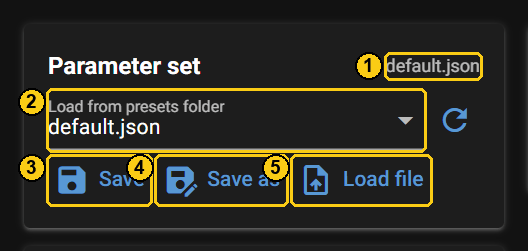

Complete designs as JSON files in `tools/filterdesign/gui/presets/`.

1. **Current file** - "• modified" behind it means unsaved changes; loading another set
   then asks before discarding them.
2. **Load from presets folder** (the button beside it rescans the folder).
3. **Save** - overwrites the current file.
4. **Save as** - asks for a name.
5. **Load file** - loads any `.json` from disk without copying it into the folder.

#### Specification

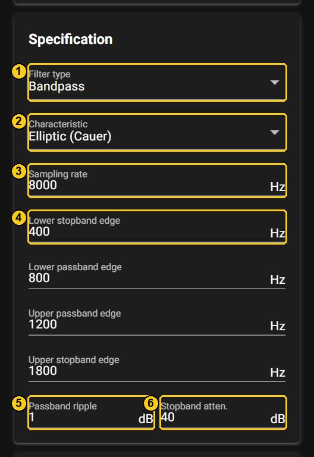

1. **Filter type** - Lowpass, Highpass, Bandpass, Bandstop.
2. **Characteristic** - Butterworth (flat, widest transition), Chebyshev type I (ripple
   in the pass band, steeper), Elliptic/Cauer (ripple in both bands, steepest for a given
   order).
3. **Sampling rate**, Hz.
4. **Band edges**, Hz - two (low/high-pass) or four (band-pass/-stop), always in
   ascending frequency order; the labels say which edge is which.
5. **Passband ripple**, dB - how much the pass band may vary.
6. **Stopband atten.**, dB - how far the stop band must be down.

#### Implementation

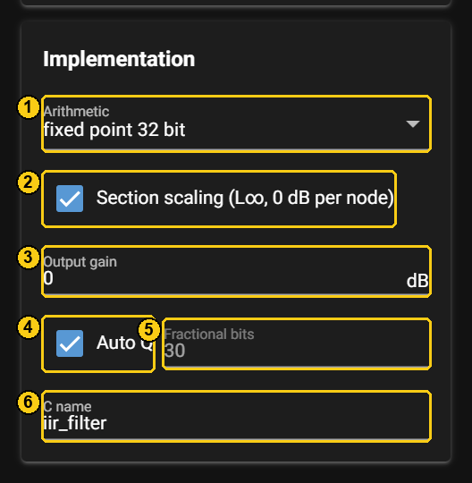

How the filter is computed in C.

1. **Arithmetic** - float (32 bit), double (64 bit), fixed point 32 bit, fixed point
   16 bit, float (32 bit, dsPIC33A assembler).
2. **Section scaling** - scales each biquad section to 0 dB at every node. Keep it on for
   fixed point, otherwise high-order filters overflow.
3. **Output gain**, dB - folded into the last section at no cost. Above 0 dB the output
   clips at 0/4095 for large signals. The plots are shown without it.
4. **Auto Q** and
5. **Fractional bits** - fixed point only: the Q format of the coefficients, normally
   chosen automatically.
6. **C name** - prefix of the generated functions (`<name>_init`, `<name>_process`,
   `<name>_process_block`) and of the downloaded files.

#### Summary

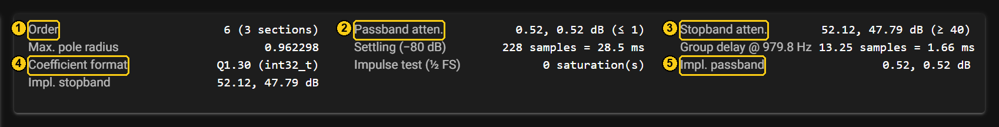

1. **Order** - digital order and number of biquad sections.
2. **Passband atten.** and
3. **Stopband atten.** - achieved, with the limit from the specification in brackets.
   Also in the summary: largest pole radius, settling time, group delay.
4. **Coefficient format** (fixed point) - Q format and integer type; "CLIPPED!" when a
   coefficient does not fit. Beside it the impulse test's saturations.
5. **Impl. passband / stopband** - the same figures for the quantized implementation.

A red or amber warning below the summary says when the fixed-point version overflows or
misses the specification.

#### Magnitude tab

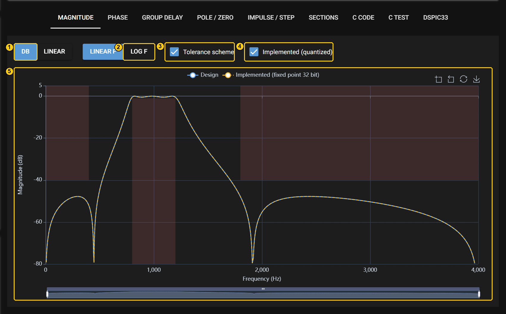

1. **dB / linear** magnitude.
2. **linear f / log f** frequency axis.
3. **Tolerance scheme** - shades the forbidden areas red; the curve must stay out of them.
4. **Implemented (quantized)** - draws the response with the chosen arithmetic (dashed)
   over the ideal design.
5. **Plot** - zoom with the mouse wheel or the box tool (top right), restore, save as
   image. The same holds for every plot in this tool.

**Phase**, **Group delay** and **Impulse / step** look alike: one toggle (wrapped /
unwrapped, samples / ms, impulse / step) and the plot.

#### Pole / zero tab

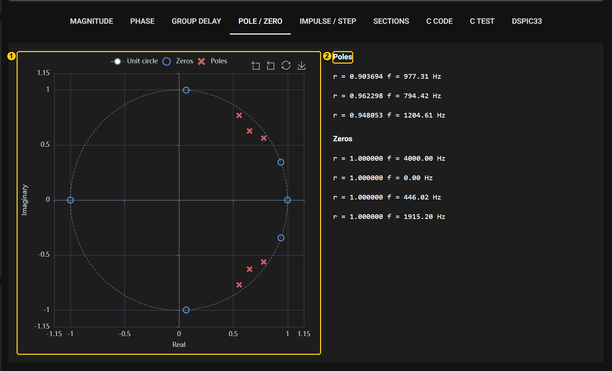

1. **z plane** - poles (x) and zeros (o) with the unit circle. Poles close to the circle
   mean a sharp filter and a long settling time.
2. **Lists** of poles and zeros with radius, frequency and multiplicity.

#### Sections tab

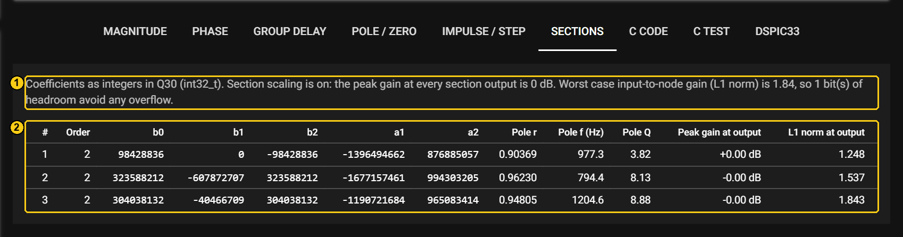

1. **Q format and scaling** in words, with the headroom needed.
2. **Coefficients** b0..b2, a1, a2 of each biquad section (integers for fixed point),
   pole radius, frequency and Q, peak gain and L1 norm at each section's output.

#### C code tab

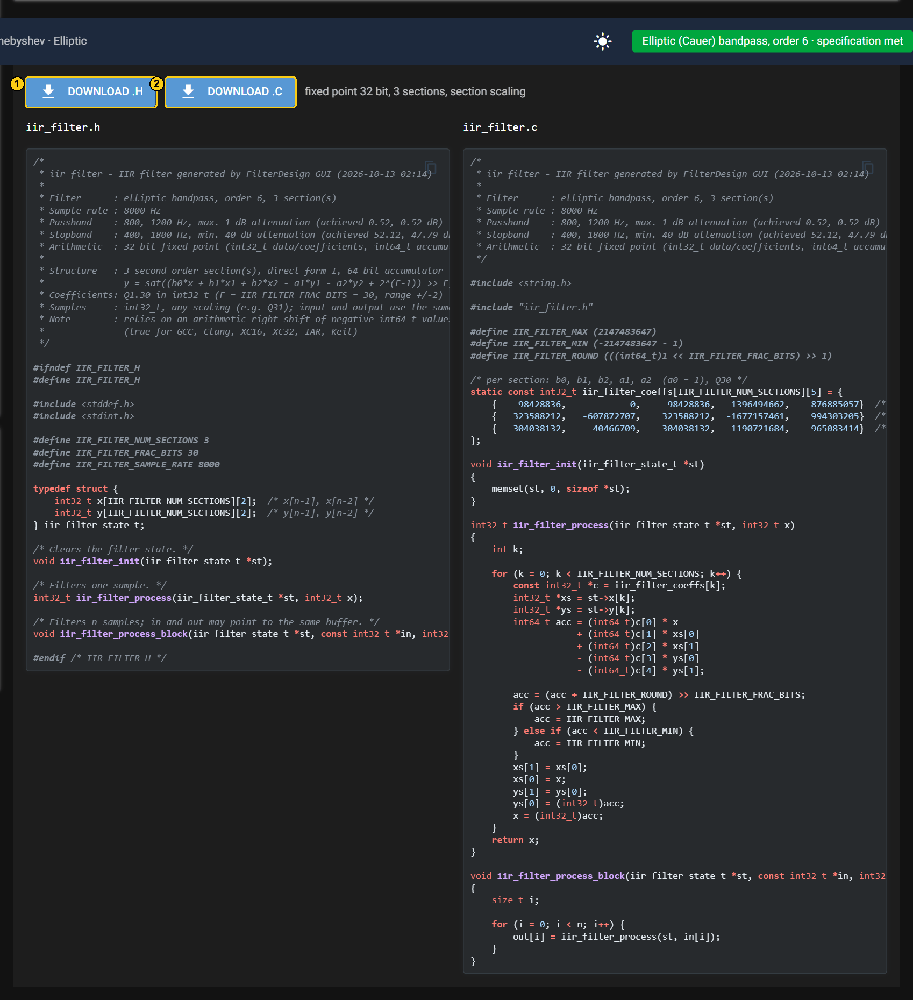

1. **Download .h** and
2. **Download .c** (**.s** for the assembler) - the generated files, into the browser's
   download folder. Both are shown below the buttons.

#### C test tab

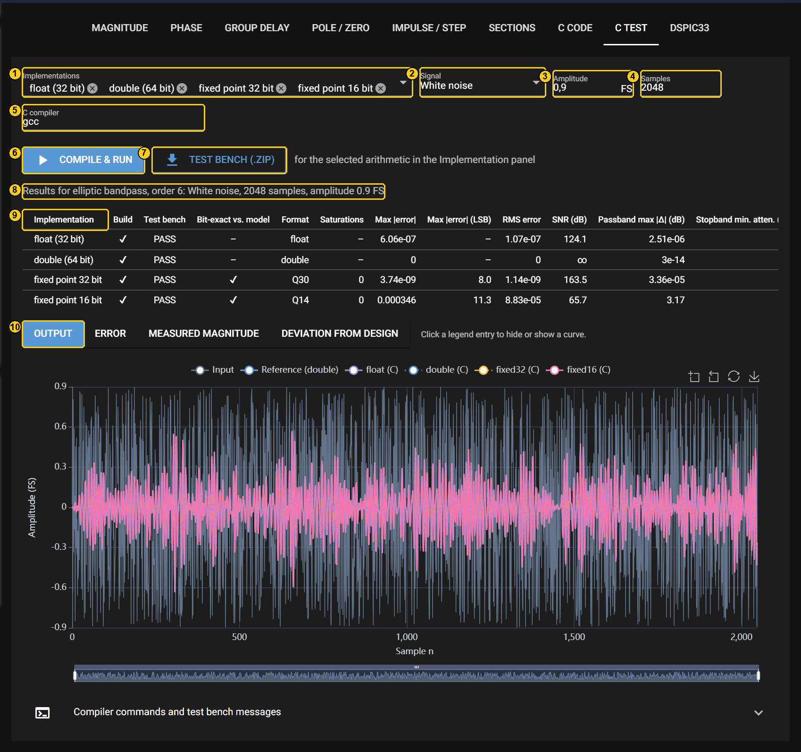

Compiles the generated code on the PC and compares it with a double-precision reference.

1. **Implementations** - which arithmetic variants to test (the assembler cannot run on
   the PC).
2. **Signal** - impulse, step, sine, chirp, white noise, multitone (sine/chirp/multitone
   add the frequency fields f1/f2).
3. **Amplitude**, in full scale.
4. **Samples**.
5. **C compiler** - default `gcc` (or `CC`).
6. **Compile & run**.
7. **Test bench (.zip)** - the filter, a test program, input and expected output and a
   Makefile for the arithmetic chosen in Implementation: `make test` prints PASS or FAIL
   on any machine with gcc.
8. **Result line** - what was tested; it says so when the design changed since.
9. **Result table** - per implementation: built, test bench PASS/FAIL, bit-exact against
   the model, format, saturations, error against the reference, SNR, measured pass band
   and stop band.
10. **View** - output, error, measured magnitude, deviation from the design. Click a
    legend entry to hide or show a curve.

### 2.3 Putting a filter onto the board (dsPIC33 tab)

The firmware has a slot for one designed filter, `sigproc user` (`src/core/user_filter.h`).
The dsPIC33 tab fills it and gets it running.

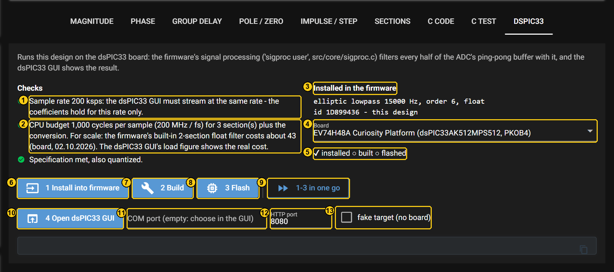

1. **Sample rate check** - the rate must be a whole number of kHz (1 kHz .. 40 MHz): the
   board streams at whole kSPS. The filter is valid only at that rate.
2. **CPU budget check** - cycles per sample at this rate against the filter's cost.
   Below 60 cycles the install is refused; above about 8 MSPS the stream itself loses
   samples. A red line in **Checks** blocks the install; an amber "misses the
   specification" is only a warning.
3. **Installed in the firmware** - what `src/core/user_filter.json` holds now, and
   whether it is this design ("not this design" in the picture: another filter is
   installed).
4. **Board** - EV74H48A (flashed through the on-board PKOB4 with `ipecmd`) or EV17P63A
   Curiosity Nano (flashed by copying the .hex onto its USB drive).
5. **Progress** - installed / built / flashed, ticked for the current design.
6. **1 Install into firmware** - writes `src/core/user_filter.h` and `.json`.
7. **2 Build** - runs `tools\build.bat` (or `build.bat nano`), about 20 s.
8. **3 Flash** - programs the board, 20 to 40 s. **Do not unplug the board or close the
   page meanwhile.** Close MPLAB X's project first if it holds the programmer.
9. **1-3 in one go** - all three, stops at the first failure.
10. **4 Open dsPIC33 GUI** - starts `adc_gui.py` in its own window with the `user` filter
    preselected.
11. **COM port** for it (empty: choose in the GUI),
12. **HTTP port** for it (default 8080), and
13. **fake target (no board)** - start it against the stand-in.

The log below the buttons shows the output of every step, newest on top.

**In the dsPIC33 GUI** (chapter 3): signal processing card -> **user filter** -> **use
its rate** -> **filter on**, then **live**; or press **noise test** to measure the
response against the design (section 3.4).

**Back to the default filter.** Installing changes two files tracked in git. To restore
the default (elliptic low-pass, 200 kSPS, 15/25 kHz):

```
python tools\filterdesign\gui\firmware.py --default
```

then build and flash again. Or load the preset `dspic33_default_lowpass_200k` and run
steps 1-3.

### 2.4 Command line

```
filterdesign.bat [--port 8090] [--host 0.0.0.0] [--no-browser] [--light] [--presets DIR]
```

`?tab=<name>` in the URL opens a tab directly (e.g. `?tab=ctest`, `?tab=dspic33`).

---

## 3. dsPIC33 GUI (`adc_gui.py`)

The GUI talks to the firmware's console over the board's virtual COM port (115200 baud).
Every command waits for the firmware's acknowledgement before the next one goes out, so
the GUI and the board never talk over each other. You can watch the traffic in the
**console** card at the bottom of the page.

The page has a header, a narrow left column with the settings (what the board does) and a
wide right column with the results (what came back).

### 3.1 Quick start without a board

```
adc_gui.bat --fake
```

The browser opens, the GUI connects to a built-in stand-in for the board, and the header
chip turns green. Then:

1. In the **acquisition** card press **single**: one buffer is grabbed and drawn in the
   **time signal** and **spectrum** plots. With the default input (the test triangle) the
   **triangle verdict** card shows **PASS**.
2. Press **live**: the GUI grabs again and again (every 500 ms by default). Press
   **stop** to end it.
3. Set **input** to **custom input**: the stand-in now plays a sine (set in the **fake
   target signal** card), and the **signal evaluation** chips show SNR, THD and harmonics.
4. Pick an entry in the **setup** list of the **settings file** card to see ready-made
   configurations (DAC triangles, signal generator shapes, Goertzel checks, noise tests).

`--fake --fake-board EV17P63A` makes the stand-in report the Curiosity Nano instead.

### 3.2 First measurement on the board

1. Flash the firmware (`tools\build.bat`, then MPLAB X/IPE, or from FilterDesign's
   dsPIC33 tab). Plug in the board's USB. On the EV74H48A the console is the MCP2221A's
   COM port; on the Curiosity Nano it is the nEDBG's.
2. Start the GUI with the port: `adc_gui.bat --port COM7` (your number), or start
   `adc_gui.bat`, choose the port in the **port** list in the header and press
   **connect**. The list is read when the page is built: a board plugged in later needs
   a page reload (F5).
3. The header chip shows the first line of the firmware's `version` reply, the board, and
   the round trip time ("RTT 3 ms"). The GUI switches to the board the firmware reports
   by itself.
4. Leave **input** at **RA8 / DAC2 test triangle**: the firmware drives its own triangle
   on DAC2, and ADC core 5 reads it back on RA8 inside the chip, so no wiring is needed.
5. Press **single**, then **live**. Watch the counter chips above the plots: **overrun**,
   **late** and **missed** must stay green (0). The **triangle verdict** must say
   **PASS**.
6. Raise **rate, kSPS** step by step. The hint under the field tells you where the board
   has shown trouble before: clean to about 8000 kSPS, DMA overruns from about 10000,
   lost triggers from about 16000. It is guidance, not a limit.
7. Press **stop** before you unplug, or press **disconnect**: the GUI stops the stream
   (`stream off`) and closes the port.

### 3.3 The page, card by card

Clicking a card's title folds it away (▸) or opens it again (▾). The folded cards are
remembered at once. The **tooltips** checkbox in the header turns all tooltips off once
you know the page.

#### Header

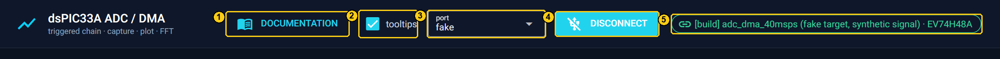

1. **documentation** - shows `docs/ARCHITECTURE.md` (block diagrams) in a dialog.
2. **tooltips** - all tooltips on/off (saved with the settings).
3. **port** - `fake` (the built-in stand-in), `remote` (a remote bench: a relay drives the board,
   see the header of `tools/remote.py`), or one of the PC's COM ports.
4. **connect / disconnect** - opens or closes the connection. Disconnect stops a running
   stream first.
5. **Status chip** - grey "not connected"; green with the firmware's version line, the
   board and the round trip time; red "connect failed: ..." with the reason.

#### settings file

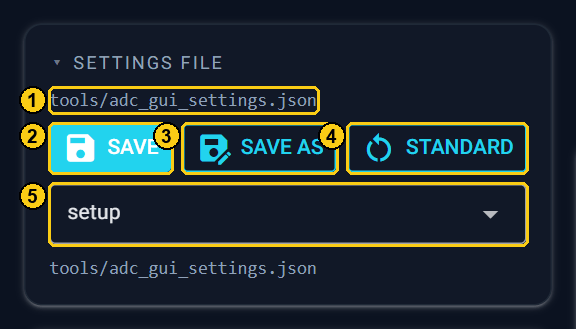

Every value on the page lives in a JSON file.

1. **The file in use** - by default `tools/adc_gui_settings.json` (private, not in git).
   It is read at every start, on top of the standard `tools/adc_gui_defaults.json`.
2. **save** - writes the current page into that file.
3. **save as** - writes to another file, which then becomes the file in use.
4. **standard** - puts every control back to `tools/adc_gui_defaults.json`. Press
   **save** to keep it.
5. **setup** - applies a ready-made configuration at once (and to the board, if
   connected): input, rate, DACs, generator, filter, trigger. Everything a setup does not
   name stays. The last entry, **from a file ...**, loads a settings file.

#### acquisition · triggered chain

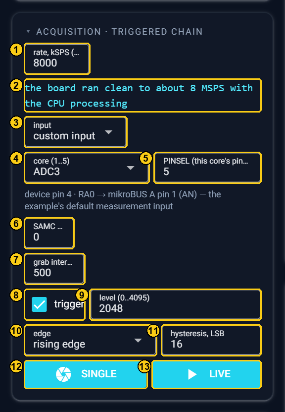

What the ADC samples, how fast, and the two buttons that start it.

1. **rate, kSPS** - the sample rate, 1..40000. The board makes the nearest rate it can;
   the **actual rate** chip shows it. A change while live is taken over before the next
   grab.
2. **Guidance** - what this rate did on the board so far (cyan: clean, amber: close to
   overruns/lost triggers, red: beyond what was reached). Not a limit.
3. **input** - **RA8 / DAC2 test triangle** (core 5, PINSEL 3: the firmware's own
   triangle, read back inside the chip) or **custom input**.
4. **core (1..5)** - the ADC core for a custom input.
5. **PINSEL** - that core's input channel; the line below names the device pin and where
   it is on the board. Locked (like 4 and 6) while the test input is selected.
6. **SAMC** - sample time, 0..31 ADC clocks; raise it for a high-impedance source.
7. **grab interval, ms** - pause between two grabs in live mode.
8. **trigger** - makes the time plot stand still like an oscilloscope. Display only: the
   stream, the FFT and the verdict are not affected.
9. **level** - the trigger level in ADC counts (dashed line in the plot).
10. **edge** - rising or falling.
11. **hysteresis, LSB** - the signal must first go this far to the other side of the
    level, so noise on a slow slope does not fire the trigger early.
12. **single** - starts the stream if needed, grabs once, stops the stream.
13. **live / stop** - grabs repeatedly until **stop**; **stop** sends `stream off`.

While live runs the stream never stops: each grab sends the buffer pair just completed
while the DMA carries on in the other one.

#### signal processing

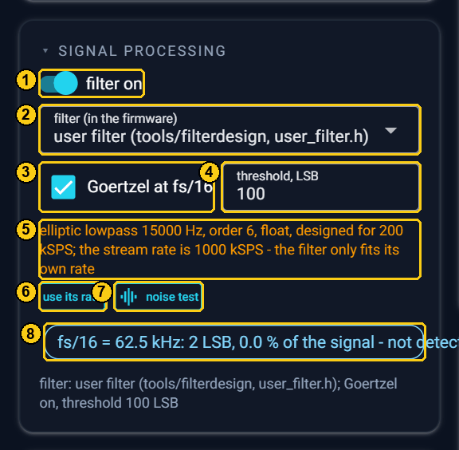

The filter that runs in the firmware on every buffer half, and a tone detector.

1. **filter on** - switches between off and the filter chosen last.
2. **filter (in the firmware)** - **off**, **low-pass / high-pass / band-pass at fs/8**
   (built in, they follow the rate), **user filter** (from FilterDesign, valid at its
   design rate only).
3. **Goertzel at fs/16** - a tone detector at a quarter of the Nyquist frequency.
4. **threshold, LSB** - amplitude above which the tone counts as detected.
5. **User filter description** (only with the user filter) - what the board reports
   about it. Amber when the stream rate is not the filter's rate, or "NOT the filter in
   src/core/user_filter.json" when the board runs a different filter than the source
   tree holds (build and flash).
6. **use its rate** - sets the stream rate to the user filter's design rate.
7. **noise test** - measures the user filter's frequency response on the board (see
   3.4 and the **filter response** card).
8. **Goertzel chip** - frequency, amplitude and share of the signal at fs/16; green
   "DETECTED" or grey "not detected".

#### fake target signal

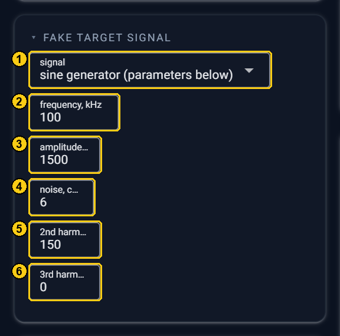

Only for `--fake`: what the stand-in plays on a custom input.

1. **signal** - sine generator (fields below), DAC2 triangle or DAC1 triangle.
2. **frequency, kHz**
3. **amplitude, counts (pk)**
4. **noise, counts** - standard deviation; sets the SNR.
5. **2nd harmonic** and
6. **3rd harmonic**, counts (pk) - give THD and H2/H3 something to show.

#### dac1 · triangle (RA1) and dac2 · triangle (RA8)

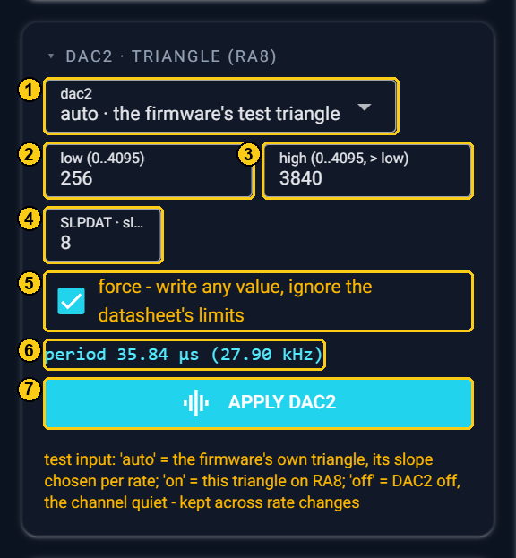

Each DAC can make a triangle on its pin. The DAC1 card is the same without **auto**.

1. **Mode** - **on**, **off**, and for DAC2 **auto** = the firmware's own test triangle.
2. **low** and
3. **high** - the turning points in DAC codes (0..4095, high > low).
4. **SLPDAT** - the slope, codes per DAC clock (8 = about 22 kHz).
5. **force** - lets values outside the datasheet's limits through.
6. **Period** - the resulting triangle period and frequency.
7. **apply dac2** - sends at once. Any change is also sent by itself 0.8 s after the last
   edit.

DAC1 (RA1) is only read through a custom input (core 5, PINSEL 1). While the signal
generator plays on a DAC, the card leaves that DAC alone; switching the card to **on**
replaces the generator with the triangle.

#### signal generator · table -> DMA2 -> DAC

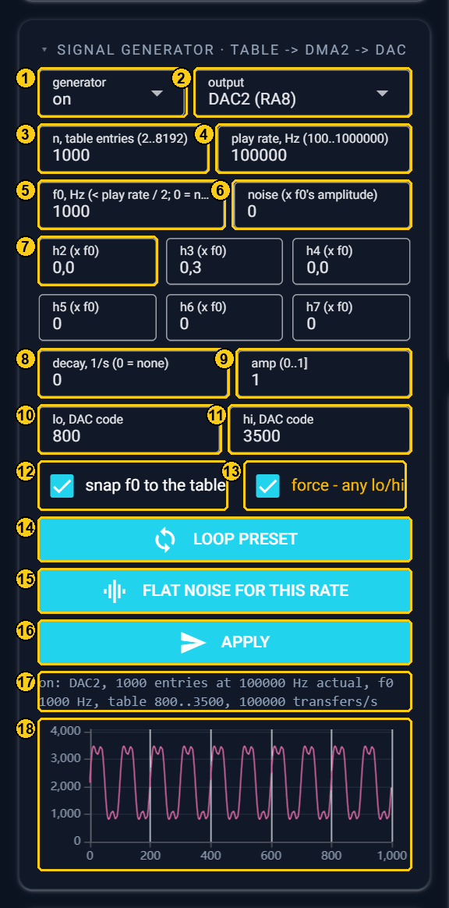

An arbitrary waveform: a table computed from the fields, played by DMA channel 2 onto a
DAC.

1. **generator** - on/off.
2. **output** - DAC1 (RA1) or DAC2 (RA8).
3. **n, table entries** - table length.
4. **play rate, Hz** - table entries per second; the table repeats every n / play rate.
5. **f0, Hz** - the fundamental (0 = no tone).
6. **noise** - white noise in multiples of f0's amplitude (with f0 = 0: noise alone).
7. **h2 .. h7** - harmonics as multiples of f0's amplitude.
8. **decay, 1/s** - envelope exp(-decay x t) from the table's start; 0 = steady tone. To
   fall to 1 % within T: decay = 4.6 / T.
9. **amp** - overall amplitude, 0..1.
10. **lo** and
11. **hi** - the DAC code range (800..3500 by default: the DAC does not follow below
    about code 780).
12. **snap f0 to the table** - moves f0 so a whole number of periods fits the table.
13. **force** - any lo/hi.
14. **loop preset** - 1 kHz + 3rd harmonic on DAC2, read back on RA8 (core 5,
    PINSEL 3): the time plot overlays the expected curve and the **loop** chip shows the
    match (picture under "time signal").
15. **flat noise for this rate** - white noise on DAC2 at twice the sample rate
    (max. 1 MHz).
16. **apply** - sends now (otherwise 0.8 s after the last edit).
17. **Status** - what the board plays, with the actual play rate.
18. **Preview** of the table.

The test input needs DAC2 for its own triangle: selecting it switches a generator on DAC2
off.

#### buffer

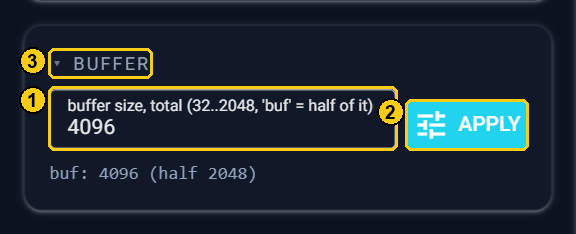

1. **buffer size, total** - one ping-pong pair (both halves), even, 32 to the board's
   maximum (2048).
2. **apply** - sends `buf`; a running stream restarts with the next grab.
3. **What the board took** - "buf: N (half N/2)".

#### Grab line and status chips (top of the right column)

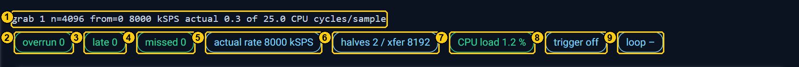

1. **Grab line** - grab number, samples, start index, the actual rate, CPU cycles used of
   the cycles available per sample, grabs per second. Red on an error.
2. **overrun**,
3. **late** and
4. **missed** - errors since the previous grab: DMA overruns, interrupts a whole half
   late, halves the processing was too slow for. Green = 0, red otherwise.
5. **actual rate** - the sample rate the board really ran; the plots use it.
6. **halves / xfer** - buffer halves and DMA transfers.
7. **CPU load** - share of a half period the processing took; green below 70 %, red above
   100 %.
8. **trigger** - "trig @ k" where the trigger fired, or "no trigger".
9. **loop** - in the generator loop: rms difference to the expected curve, gain, table
   entry.

#### time signal

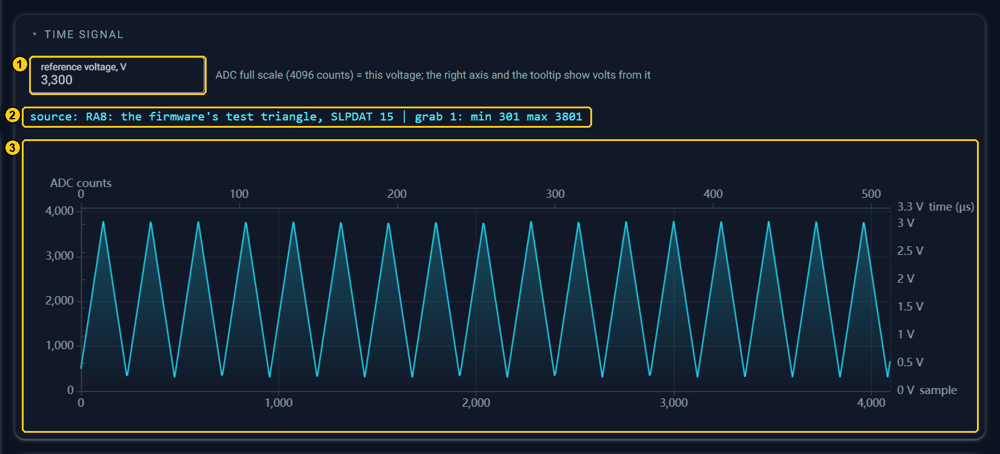

1. **reference voltage, V** - full scale (4096 counts) in volts; sets the right axis and
   the tooltip.
2. **Source line** - what is on the input, and min/max of this grab.
3. **Plot** - samples over time: left axis ADC counts, right axis volts, bottom axis
   sample number, top axis time. Hover for single values; mouse wheel and drag zoom.

With **trigger** on, the plot starts at the crossing of the level (dashed line) and shows
half the grab:

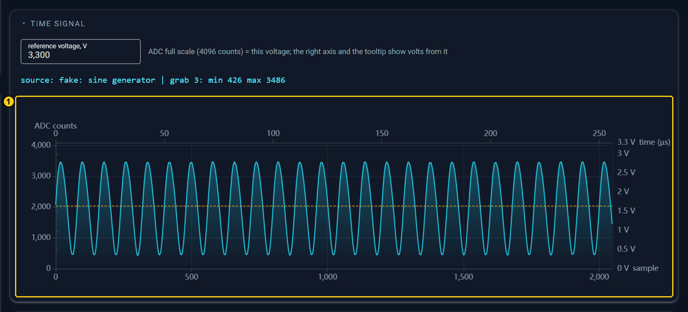

With the generator's **loop preset**, the expected curve is drawn over the measured one,
and the **loop** chip above the card says how well they match:

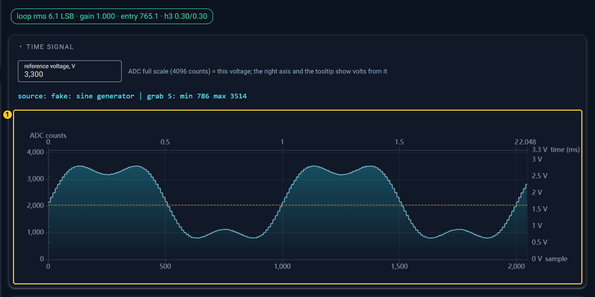

#### spectrum · Hann window

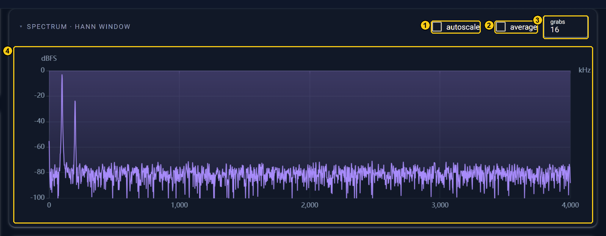

1. **average** - averages the power of the last N grabs (for noise and small lines); it
   starts over when the rate, length or filter changes.
2. **grabs** - N.
3. **Plot** - FFT of the grab in dBFS (0 dB = full scale). Dashed lines mark fs/8 (corner
   of the built-in filters) and fs/16 (Goertzel) when they are on.

#### filter response · noise test

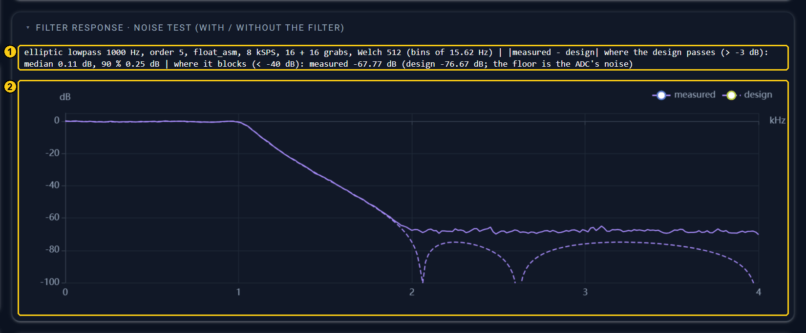

Appears once a noise test has run (button 7 in **signal processing**).

1. **Summary** - filter, rate, number of grabs, and how far the measured response lies
   from the design: median and 90 % deviation where the design passes, the level where it
   blocks (the floor there is the ADC's own noise).
2. **Plot** - measured response (solid) and design (dashed) in dB over kHz.

#### signal evaluation

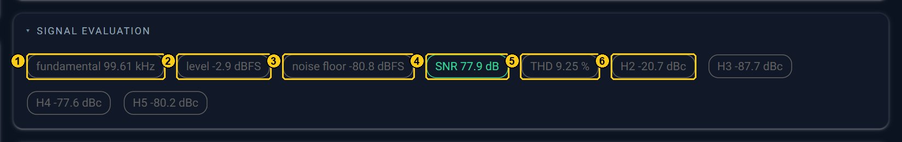

1. **fundamental** - frequency of the strongest line.
2. **level** - its level in dBFS.
3. **noise floor** - median of the spectrum outside the fundamental and its harmonics.
4. **SNR** - green from 40 dB.
5. **THD** - harmonics 2..5 against the fundamental.
6. **H2** (and H3..H5 beside it) - each harmonic in dBc.

Meaningful for a sine; for a triangle the harmonics are of course large.

#### triangle verdict · test input only

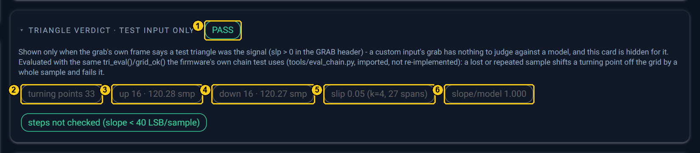

Checks the firmware's test triangle sample by sample, with the same code as the
firmware's own chain test.

1. **PASS / FAIL** - FAIL means a sample was lost or repeated somewhere in the grab.
2. **turning points** - number of corners found.
3. **up** and
4. **down** - number and length (samples) of the rising and falling slopes.
5. **slip** - how far the corners lie off the expected grid; a lost sample moves them by
   a whole sample.
6. **slope/model** - measured slope against the one expected for this rate (1.000 =
   exact).

Hidden when there is no triangle to check (custom input, filter on, DAC2 off).

#### chip · pinout and board · where to wire it

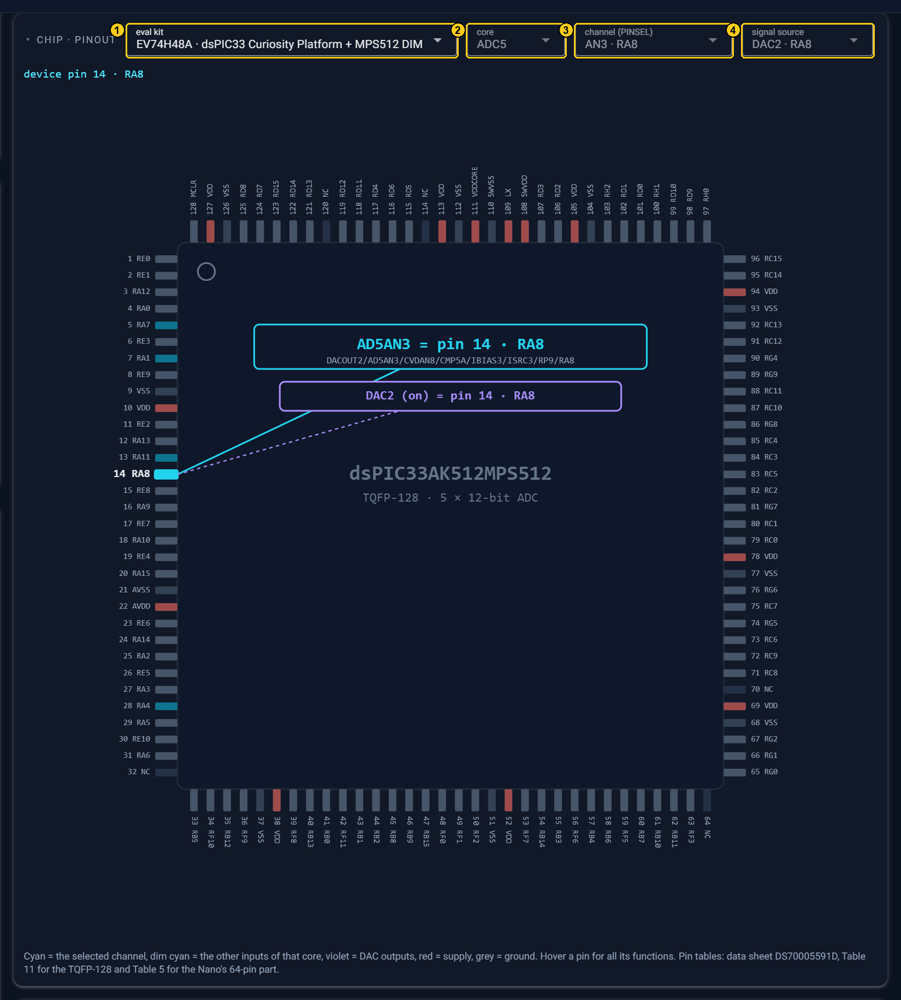

1. **eval kit** - EV74H48A or EV17P63A.
2. **core**,
3. **channel (PINSEL)** and
4. **signal source** - the same selection as in the acquisition card (changing it here
   changes it there). Cyan = the selected input, violet = DAC outputs, red = supply,
   grey = ground. Hover a pin for all its functions.

The board card shows the same on the evaluation board, with the connector pad to wire to:

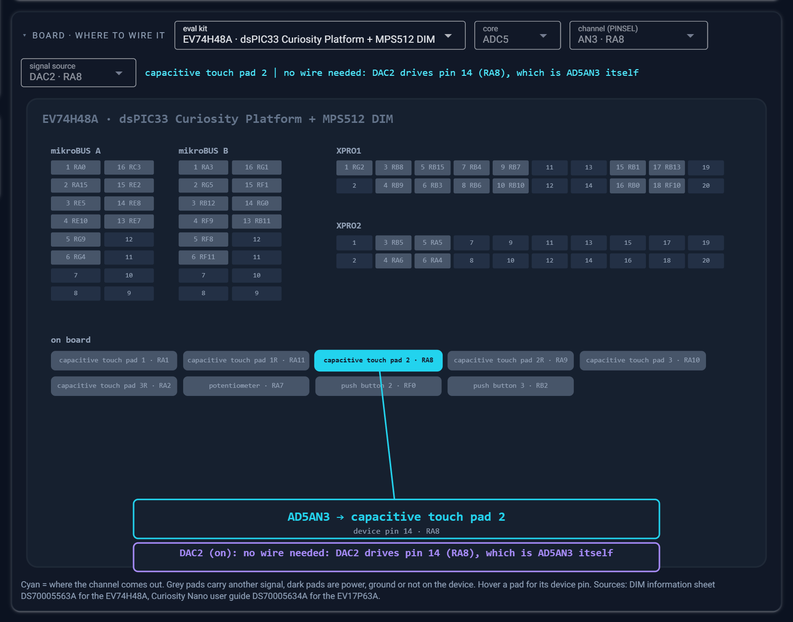

#### console

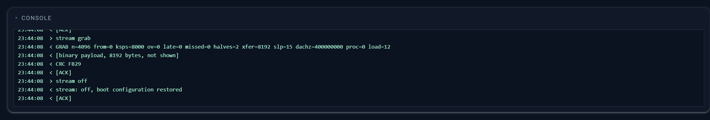

Every line sent to and received from the board, with time stamps (last 1000 lines). The
first place to look when something does not do what you expect.

### 3.4 Typical tasks

**Measure an external signal.** Set **input** to **custom input**, pick **core** and
**PINSEL** so that the info line (and the board card) show the pin you wired to. Keep the
signal within 0..3.3 V. Choose a rate at least twice the highest frequency in the signal,
press **live**. Switch **trigger** on for a still picture, **average** for a clean
spectrum.

**Check that nothing is lost at a rate.** Test input, set the rate, **live** for a while.
Every grab must show PASS and overrun/late/missed at 0. Repeat with a filter on: then the
CPU load chip shows whether the processing keeps up (missed counts the halves it did not).

**Look at a waveform from the generator.** Pick a "generator - ..." entry in **setup**, or
press **loop preset**. The time plot shows the measured signal and the expected curve.

**Measure the user filter's response on the board.**

1. Select **user filter** in the signal processing card. Press **use its rate** if it is
   offered (the filter's coefficients hold only at its design rate).
2. Press **noise test**. The GUI stops live, plays white noise on DAC2, grabs N times with
   the filter off (reference), N times with the filter on, and draws the measured
   response against the design in **filter response · noise test**.

The setups "noise - white noise on DAC2, the user filter, 200 kSPS" and "... no filter"
show the same by hand. Above 500 kSPS the generator cannot play the noise fast enough.

**Detect a tone (Goertzel).** Tick **Goertzel at fs/16**, set the **threshold**. The four
"Goertzel check" setups show a tone that should be detected and three that should not.

**Keep a configuration.** **save** (personal default for the next start) or **save as**
(a named file; load it again with setup -> **from a file ...** or `--settings <file>`).

### 3.5 Command line

```
adc_gui.bat [options]
```

| Option | Meaning |
|---|---|
| `--port COM7` | connect to this port at start |
| `--fake` | connect to the built-in stand-in |
| `--fake-board EV17P63A` | the stand-in reports the Curiosity Nano |
| `--remote`, `--bench-client PATH` | connect through a remote bench (header of `tools/remote.py`) |
| `--settings FILE` | settings file to read and save |
| `--sigproc off\|lp\|hp\|bp\|user` | preselect the firmware filter (FilterDesign starts the GUI with `user`) |
| `--http-port N` | page port (default 8080) |
| `--no-browser` | do not open a browser window |
| `--selftest` | no page: run the stand-in through a cycle and print PASS/FAIL |

---

## 4. When something goes wrong

| Symptom | Cause / what to do |
|---|---|
| `adc_gui.bat`: "No tools\.venv yet" | run `gui_setup.bat` once |
| COM port missing in the list | plugged in after the page was built: reload the page (F5). Check the Device Manager. |
| "connect failed" | wrong port, or the port is open in another program (terminal, MPLAB X data visualizer). Close it and connect again. |
| connected, but **single** gives "stream on refused" | look at the **console** card for the firmware's reply; an old firmware may lack the command - flash the current one |
| overrun / late / missed red | the rate is too high for the stream or for the filter; lower it, or switch the filter off |
| "NOT the filter in src/core/user_filter.json" | the board runs an older user filter: build and flash |
| user filter response looks wrong | the stream rate is not the filter's design rate: **use its rate** |
| FilterDesign: "fdesign executable not found" | no gcc on the PATH; install MinGW-w64/MSYS2 or set `CC` / `FDESIGN` |
| "Not installed: Sample rate ..." | design for a whole number of kHz |
| "The .hex is older than user_filter.h - build first" | press **2 Build** before **3 Flash** |
| Flash: "programmer not found" | the board's PKOB4 USB port is not connected |
| Flash failed, MPLAB X running | MPLAB X holds the programmer: close the project or MPLAB X, flash again |
| Flash: "err -10121" | the PKOB4's USB link is stuck: **unplug the board's USB cable and plug it in again**, then flash. Retrying without that does not help. The chip may be erased until a flash succeeds. |
| Flash hangs | wait - the tool stops it by itself after 240 s. **Never kill `ipecmd` or java by hand**: that leaves the PKOB4 stuck until a USB re-plug. |

Every flash from FilterDesign adds a line to `build/flashlogs/history.txt`; a failed one
also saves `build/flashlogs/<time>/` with the programmer's output and the processes that
were running. More on the firmware side: `docs/TROUBLESHOOTING.md`.
