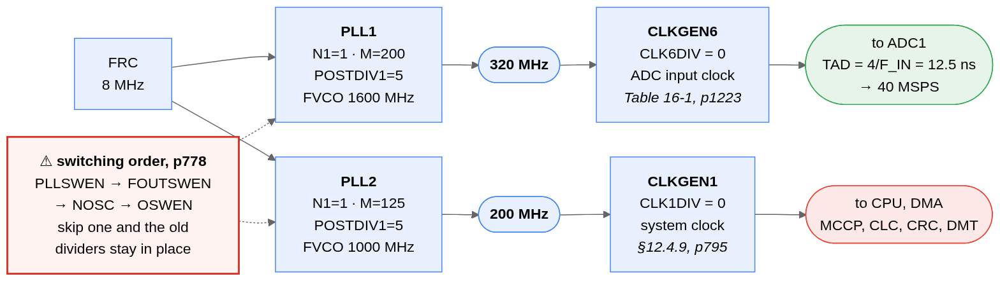
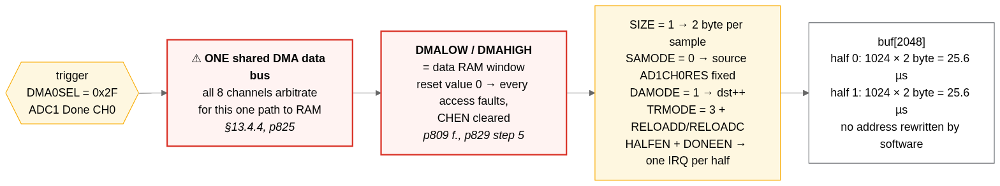
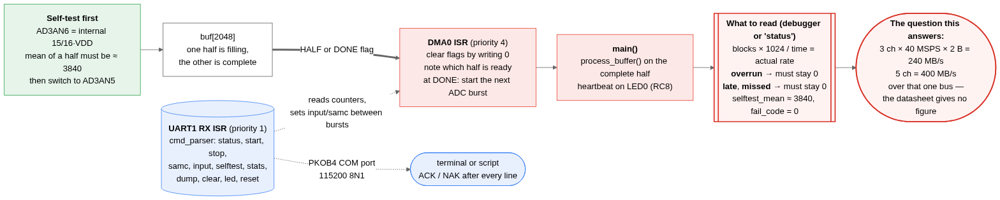

# How the example works, and what it can and cannot do

Clock tree, ADC, DMA and CPU, the sample rates you can get, what to measure, and the device's traps. Moved out of the top-level README on 13.10.2026, unchanged apart from the notes marked 13.10.2026; only links were adjusted to the new place.

> **Note (13.10.2026): much of this document describes the old back-to-back mode.** It was
> written for runs 1 to 13: the ADC in Integration mode, bursts of 2048 conversions, a
> software restart per buffer. Since 25.09.2026 the example's data path is the **triggered
> chain**: SCCP1 triggers one conversion per sample, DMA channels 0 and 1 form a hardware
> ping-pong pair (section 3, "Two ping-pong pairs"), and the dsPIC33 GUI uses nothing else;
> the back-to-back commands stay in the firmware for a terminal. Where a passage speaks of
> bursts, the burst restart or 40 MSPS, it describes the old mode. Measured on the triggered
> chain: clean to about 8 MSPS with the CPU processing, DMA overruns from about 10 MSPS,
> lost triggers from about 16 MSPS, and the ADC converts at only 18-20 MSPS in triggered
> single mode. The current state: `HARDWARE-LOG.md`.

## Contents

- [How it works](#how-it-works)
  - [1. Clock tree](#1-clock-tree)
  - [2. ADC — one core, one channel, bursts of 2048 conversions back-to-back](#2-adc--one-core-one-channel-bursts-of-2048-conversions-back-to-back)
  - [3. DMA into one buffer with two halves](#3-dma-into-one-buffer-with-two-halves)
  - [4. What the CPU does, and what to measure](#4-what-the-cpu-does-and-what-to-measure)
- [Which sample rates you can get](#which-sample-rates-you-can-get)
- [The point of the whole thing](#the-point-of-the-whole-thing)
- [What to measure](#what-to-measure)
- [If the bandwidth is not enough](#if-the-bandwidth-is-not-enough)
- [What this code does not do](#what-this-code-does-not-do)
- [Errata](#errata)
- [One trap worth knowing about](#one-trap-worth-knowing-about)

## How it works

### 1. Clock tree



The part that differs from many other devices: **the fast peripherals do not hang off
the system clock.** There are two dedicated PLLs and fourteen clock generators, so
320 MHz at the ADC alongside a 200 MHz CPU is no contradiction. This example uses both
PLLs — PLL1 at 320 MHz for the ADC, PLL2 at 200 MHz for the system — so neither clock
needs a fractional divider.

**The switching order matters and is easy to get wrong.** Page 778 requires `PLLSWEN`
(apply input and feedback dividers), then `FOUTSWEN` (apply output dividers), then
`NOSC`, then `OSWEN`. Setting only the last two does not produce an error — it silently
leaves the old dividers in place and the part runs at the wrong speed.

Which generator feeds what is not stated in one place:

- **CLKGEN1 is the system clock** — §12.4.9, page 795: *"Clock Generator 1 is the
  clock source for the system clock (sys_clk) and peripheral clock."*
- **CLKGEN6 is the ADC clock** — Table 16-1, page 1223, column "Clock Source",
  together with "Max Input Clock 32 MHz to 320 MHz".

TAD derives from the ADC input clock: **TAD = 4 / F_IN** (parameter AD50, Table 40-39,
page 2034). At 320 MHz that is 12.5 ns, which is also the minimum — more than 320 MHz
is not specified (Table 40-24, page 2016). Hence the 40 MSPS (AD51, throughput
including 1.5 TAD conversion time).

A useful cross-check: the datasheet measures its own current consumption at exactly
this operating point — *"Input frequency 320 MHz, ADC clock 80 MHz, TAD 12.5 ns"*
(DC120/DC121, page 2008). So this is the intended setting, not brinkmanship.

`CLKxDIV` also has a 9-bit fractional divider `FRACDIV` next to the integer `INTDIV`,
so non-integer ratios are possible — but this example does not need one: both clock
generators take their PLL output straight through, `CLK1DIV = CLK6DIV = 0`.

### 2. ADC — one core, one channel, bursts of 2048 conversions back-to-back

> **Note (13.10.2026): the SCCP1 result below is out of date.** SCCP1 does trigger the ADC:
> with trigger code 32 (SCCP1 per the device pack's ATDF) in timer mode it is the trigger of
> today's chain, and `src/drivers/sccp.c` is back. Run 7 used code 34, which is SCCP3, and
> output-compare mode, which produced no events.

`MODE = 10` is Integration mode: a software trigger (`TRG1SRC = 1`, `AD3SWTRG`) starts a
burst, and every following conversion inside it is started by `TRG2SRC`. `CNT` is the
number of conversions in the burst and is tied to the DMA buffer, so one burst is one
full buffer and the DMA's `DONE` interrupt is also the moment to start the next one.
`IRQSEL = 0` raises the channel event after **every** conversion, and that event is what
triggers the DMA.

**`TRG2SRC = 2`, back-to-back, and nothing else.** The datasheet offers a repeat timer
(`TRG2SRC = 3` with the period in `RPTCNT`) and external triggers such as SCCP1
(`TRG2SRC = 34`). On this silicon none of them work:

| Tried | Result on the board |
|---|---|
| Repeat timer, `RPTCNT` 2 … 63 | register holds the value, rate does not change (runs 5, 6, 7) |
| SCCP1 as second trigger, code 34, `AUXOUT = 01` | **no conversion at all** (run 7) |
| One conversion per SCCP1 trigger, Single Conversion mode, `TRG1SRC = 34` | **no conversion at all** (run 7) |
| Sample time `SAMC` 0 … 31 | rate does not change (run 4) |

All four were removed from this example after run 7, together with `sccp.c/.h`. What
remains is the one mechanism the hardware honours, and the rate is set by the ADC clock —
see *Which sample rates you can get*.

The per-conversion result is `ADxCH0RES[11:0]`. `ADxCH0DATA` is the burst accumulator
(page 1270) and is **not** what the DMA reads.

### 3. DMA into one buffer with two halves

**Two ping-pong pairs for the triggered stream (since 01.10.2026).** The 8 KB buffer holds
pair A and pair B, each a ping half and a pong half of up to 1024 samples. `stream on` runs
two DMA channels as the dsPIC33A's hardware ping-pong pair (DS70005591D 13.4.11): channel 0
fills the ping half, channel 1 the pong half, and the hardware hands over between them
without a lost sample (checked on the board with the DAC triangle up to 16 MSPS). For a
`stream grab` the channel that is waiting is pointed at the other pair, so the pair just
completed stands still and goes to the GUI while acquisition and processing carry on in
the other pair - nothing stops, the processing never sees a gap in its input. The GUI
sees snapshots of the signal, one pair at a time. The back-to-back commands (`start`,
`test`, `blk`, ...) still use one channel on pair A as described below.



| Field | Value | Why |
|---|---|---|
| `DMALOW` / `DMAHIGH` | 0x4000 / 0x13FFF | **the data RAM window — mandatory.** Both reset to 0; every transaction is checked against them (page 829, step 5) and an access above `DMAHIGH` sets `ADRERR` and clears `CHEN` (pages 810, 826). Taken from the device header (`__DATA_BASE`, `__DATA_LENGTH`). |
| `DMA0SEL` | 0x3B | trigger source "ADC3 Done CH0" (ATDF value group `DMA_SEL__CHSEL`; 0x2F … 0x48 for ADC1 … 5, follows `ADC_INSTANCE`) |
| `DMA0SRC` | `&AD3CH0RES` | the per-conversion result register |
| `SIZE` | 1 | **16-bit transfers** (page 812) |
| `SAMODE` | 0 | source address stays put |
| `DAMODE` | 1 | destination increments |
| `TRMODE` | 1 | repeated one-shot: one transfer per trigger (page 832). Was 3 (repeated continuous, a whole block per trigger) until 25.09.2026 |
| `RELOADD`, `RELOADC` | 1 | back to the buffer start after each block, in hardware (page 812) |
| `HALFEN`, `DONEEN` | 1 | one interrupt when the first half is full, one when the second is (page 848) |

**On 2 bytes per sample:** the DMA handles 8, 16 and 32-bit transactions, selected
through `SIZE[1:0]`. A 12-bit result therefore costs 2 bytes, not 4. `AD3CH0RES` is
32 bits wide with `RES[11:0]` in the low half and `RESF[11:0]` in bits 31:20 (register
summary, page 1229), so the 16-bit read of the low half is the sample.

**On the two halves:** the first version of this code used two separate buffers and
rewrote `DMA0DST` from the ISR to swap them. That cannot work at this rate — with
`RELOADD` the DMA restarts at the old address the moment a block completes, samples
keep arriving every 25 ns, and by the time the ISR rewrites the pointer a dozen of
them have landed in the buffer the CPU is reading, while the rest of the block goes
to the new address minus those samples. The hardware has the right tool for this:
the `HALF` flag. One buffer of 2048, an interrupt at the halfway point and one at the
end, and **no address is ever touched by software while the channel runs**.
(The device also has a hardware ping-pong mode across a channel pair, `PPEN`/`PCHEN`,
§13.4.11 page 841 — more than this example needs.)

**On the status flags:** `DMAxSTAT` bits are *R/C/HS* — set by hardware, **cleared by
writing 0** (legend page 815; Example 13-4 page 835 does `DMA0STATbits.DONE=0`).
Writing 1, as the first version did, leaves them set.

At 40 MSPS one half is 25.6 µs of signal and the interrupt arrives at about 39 kHz.
The ISR only clears flags, notes which half is complete, counts errors and — at `DONE`
— restarts the ADC burst. Deliberately short, because at this rate a long ISR becomes
the cause of the next overrun.

### 4. What the CPU does, and what to measure



**Your own processing goes into `src/core/sigproc.c`** (`sigproc_block()`). As an example
it holds, selectable since 02.10.2026 (`sigproc lp|hp|bp|off`, the GUI's **signal
processing** card), one of three **4th-order Butterworth filters at fs/8** - low-pass,
high-pass, or a band-pass one octave wide around fs/8 (high- and band-pass centred on
mid-scale, 2048) - and, independently, a **Goertzel detector for a tone at fs/16**
(`sigproc gz on|off`, `sigproc gz thr <lsb>`), which measures the input before the filter
and reports the tone's amplitude, its share of the signal's power and detected or not
(GRAB `gz=`/`gzs=`/`gzd=`, the card's fs/16 chip). Being fractions of fs, all of them
follow the sample rate by themselves. Coefficients: `tools/sigproc_design.py`. Each filter
is two biquad sections, float on the FPU, the state carried from block to block (the
ping-pong stream has no gaps) and restarted where the firmware reports one (`info->gap`) or
the filter changes. On the board (02.10.2026, the signal generator through DAC2 -> RA8 at
400 kSPS) all three match their design to three decimals at fs/32, fs/16, fs/8 and fs/4,
and the Goertzel finds a tone at fs/16 (1341 LSB, 100 % of the power) and nothing at the
other three. A filter costs about 63-67 CPU cycles per sample (33 % at 1 MSPS: up to
2 MSPS), the Goertzel about 7 more (it folds the block into 16 sums and needs one complex
multiply per sum, not a float recursion per sample: 3.3 % at 1 MSPS, 26 % at 8 MSPS). The
GUI's **setup** list has four Goertzel checks that drive the signal generator for it: a
sine at fs/16 (detected), at fs/8 and 3 kHz beside fs/16 (not detected), and fs/16 with the
high-pass on (filtered to 5 % in the plot, still detected - the Goertzel looks before the
filter). Replace it with your own processing as you need.
A fourth filter, `sigproc user` (03.10.2026), is not fixed: it is whatever you design in
`tools/filterdesign` - see [Your own filter](GUI-MANUAL.md#your-own-filter-the-firmware-side).
The firmware calls it from the main loop once per completed half - ping and pong alike -
while a filter or the Goertzel is on (off after reset), with the half's samples, its
length and which half it is.
The result goes
back into the same half: `stream grab` then sends the processed data to the GUI (the frame
says which filter: `proc=1` low-pass, `2` high-pass, `3` band-pass, `4` the user filter), with no second buffer. It has one half period to return (1024 samples at
8 MSPS: 128 us, 25 CPU cycles per sample); `status`, the chain test's load figures and the
GUI's "CPU load" chip (the GRAB frame's `load=`, per mille of a half period) show what it takes, and `missed` counts the halves it was too slow for. `src/core/sigproc.h` has
the rules. `chain all` and `test` judge raw samples - switch the processing off for them.

## Which sample rates you can get

All figures are **per ADC core**; the dsPIC33AK512MPS512 has five (Table 16-1, page
1223).

**The basis.** The ADC clock may run from 32 to 320 MHz (Table 16-1). The conversions run
back-to-back and eight ADC clocks make one conversion, so 320 MHz is 40 MSPS and 32 MHz
is 4 MSPS. Nothing inside the burst paces them — see the ADC section — so **the ADC clock
is the only knob.**

**The knob that works: PLL1's output dividers.** PLL1 feeds nothing but the ADC path (the
CPU runs off PLL2), its VCO is 1600 MHz, and the output is 1600 MHz / (POSTDIV1 ·
POSTDIV2) with both fields 1…7 and POSTDIV1 ≥ POSTDIV2 (page 778). `pll <p1> <p2>` sets
it; the sweep walks this ladder from the slowest rate up:

| POSTDIV1/2 | ADC clock | Rate |
|---|---|---|
| 7/7 | 32.65 MHz | 4.08 MSPS — the slowest that clears the ADC minimum |
| 7/6 | 38.10 MHz | 4.76 MSPS |
| 6/6 | 44.44 MHz | 5.56 MSPS |
| 7/5 | 45.71 MHz | 5.71 MSPS |
| 6/5 | 53.33 MHz | 6.67 MSPS |
| 7/4 | 57.14 MHz | 7.14 MSPS |
| **5/5** | **64.00 MHz** | **8.00 MSPS** |
| 6/4 | 66.67 MHz | 8.33 MSPS |
| 5/4 | 80.00 MHz | 10.00 MSPS |
| 6/3 | 88.89 MHz | 11.11 MSPS |
| 5/3 | 106.67 MHz | 13.33 MSPS |
| 6/2 | 133.33 MHz | 16.67 MSPS |
| 5/2 | 160.00 MHz | 20.00 MSPS |
| 5/1 | 320.00 MHz | 40.00 MSPS — the boot setting of `clock_init()` |

Measured on the board (run 13): one clean burst at 7/7 delivered **3990 kSPS against
4081 nominal**, 2.2 % off. The switch takes the DMA channel down, the ADC core off, the
PLL's output dividers are changed (page 778: they must not move while the PLL is
operating), the core comes back with `ADRDY` and the DMA is set up from scratch — the
boot order, run backwards and forwards again.

**The knob that does not work: the CLKGEN6 divider** (`clk`, `clock_adc_set_div()`). The
divided clock should be F_IN / (2 · (`INTDIV` + `FRACDIV`/512)) per Example 12-2, and
every ratio is written, read back and confirmed by `DIVSWEN` and `CLKRDY` — with the
generator switched off around the write and with it left running as the example
prescribes. The conversion rate does not move at any of them, and the ADC keeps
converting with CLKGEN6 switched off entirely (`test clkoff`).

> **Note (13.10.2026): this result was withdrawn.** It was measured in the wrong DMA mode
> (`TRMODE = 3`, runs 1 to 18). Run 19 measured the divider at the generator: it divides,
> 320/160/80 MHz; `ON = 0` does not stop it (`ANALYSIS.md` section E). The example still
> sets its rate through PLL1, not through this divider.
 It is kept in the firmware
so the behaviour can be reproduced, not because it is useful. Two datasheet details
apply if you try it anyway: "FRACDIV will not work if INTDIV is configured to 0" (12.4.2
4b), so no ratio between 1 and 2 exists at all; and the divider is changed with the
generator **running**.

**Below 4 MSPS** the burst mechanism is the wrong tool. For rates like the 40 kHz of a
piezo grain sensor, use Single Conversion mode with a PWM trigger as `TRG1SRC`: the DMA
transfer per conversion works exactly the same way and the burst restart disappears.
That goes down to a few Hz. Note that the SCCP1 trigger did not work on this board — a
PWM trigger has not been tried.

> **Note (13.10.2026): out of date.** Single Conversion mode triggered by SCCP1 (trigger
> code 32, timer mode) is how the example samples at every rate today, down to 100 kSPS
> and below; run 7 had used code 34, which is SCCP3.

Three caveats:

- The figures are per core. Five cores together are nominally 200 MSPS — whether the
  single DMA bus carries that is precisely the open question this example is meant to
  measure.
- The burst restart costs one interrupt latency per buffer (4096 samples at the default length), so the measured rate
  sits a few tenths of a percent below the nominal value.
- AD51 carries the footnote "design guidance only, not characterised or tested in
  manufacturing". 40 MSPS is the design target, not a tested limit.

## The point of the whole thing

One sentence in the datasheet matters more for this project than any ADC register,
§13.4.4 on page 825:

> *"While DMA channels can function independently to service different peripherals at
> the same time, they are still limited by the presence of a single DMA data bus and a
> single data channel to data space."*

**So the eight DMA channels are not eight parallel data paths.** They share one bus,
and when they contend an arbitration decides (fixed or round robin via
`DMACON.PRIORITY`). For scale: three channels at 40 MSPS and 2 bytes are 240 MB/s
across that one bus, five channels 400 MB/s. **How much it actually carries is not in
the datasheet** — there is no figure in transfers per second, and the DMA does not
appear in the peripheral clock table either.

That is why this code has counters instead of claims.

## What to measure

Read these in the debugger after a run:

| Variable | Meaning | Expectation |
|---|---|---|
| `blocks_done` | completed buffer halves | × 1024 / elapsed time = **actual sample rate** (includes the burst restart gap) |
| `dma_overrun` | `DMA0STAT.OVERRUN` seen: triggered again before the previous transfer finished (page 816) | **must stay 0**, otherwise samples were lost on the DMA bus |
| `late_service` | ISR found `HALF` and `DONE` pending together, i.e. it was more than one half late | **must stay 0** |
| `proc_missed` | `main()` did not reach a completed half before the next one finished | **must stay 0** |
| `dma_bus_err` | bus write error (`BWERR`; `BRERR` needs `RETEN`, see errata) | 0 |
| `dma_addr_err` | access outside `DMALOW`…`DMAHIGH` | 0 |
| `last_sample` | last value of the completed half | changing = data really moving |
| `ready_half` | which half completed last | alternating 0 / 1 |
| `selftest_mean` | mean of a half sampled on the internal 15/16·VDD reference | ≈ 3840 |
| `fail_code` | stop code, same number the LED blinks | 0 |

A sequence we would suggest:

1. **One channel, 40 MSPS.** Does `dma_overrun` stay at 0 over a longer run? That
   proves the basic configuration.
2. **Two channels.** Set up ADC2 the same way, second DMA channel
   (`DMA1SEL = 0x35`, "ADC2 Done CH0"). This is where the shared bus first shows its
   limit.
3. **Three channels.** If overruns appear here, the limit is found — with a number the
   datasheet cannot give you.
4. **Only then add the processing.** `process_buffer()` is deliberately written as a
   placeholder loop over every sample, so the cost of touching each value is visible.

## If the bandwidth is not enough

The ADC can average internally, before a DMA transfer even happens — Oversampling mode
(`MODE = 3`) with `ACCNUM[1:0]` in `AD3CH0CON1` (page 1266):

| `ACCNUM` | Samples | Result width |
|---|---|---|
| 0b00 | 4 | 13 bit |
| 0b01 | 16 | 14 bit |
| 0b10 | 64 | 15 bit |
| 0b11 | 256 | 16 bit |

At 16× averaging, 240 MB/s becomes 15 MB/s and the result still fits in 2 bytes with
14 bits. Sampling stays at 40 MSPS; only the output rate drops. In that mode the
averaged result lives in `AD3CH0DATA` and the channel event with `IRQSEL = 1` fires
once per average — so `DMA0SRC`, `IRQSEL` and the burst restart change accordingly.

**Whether that is an option depends on your measurement method** — for a pure
amplitude measurement it helps, for a phase-based method averaging can destroy the
information. That is worth a phone call.

`MODE[1:0]` also offers Window mode (gated by an external signal), and the last three
setting channels have a second accumulator for second-order filters.

## What this code does not do

- **No PWM and no clock output.** For an external DAC above 120 MHz a controller pin
  is not the way: the output pins are specified with 2.3 ns rise and 1.7 ns fall time
  (Table 40-26, page 2017, at 25 pF). At 120 MHz one period is 8.3 ns — four of those
  nanoseconds would be edges. The datasheet states no maximum PWM output frequency,
  and none for the Reference Clock Output either.
- **No multiple channels.** On purpose: one should be provably working first.
- **No interrupt prioritisation, no error recovery, no calibration.** The ADC can
  recalibrate itself periodically (`ACALEN` and `CALRATE` in `AD3CON`) — worth a look
  for a longer measurement.
- **No statement on analog input bandwidth.** The datasheet does not give one, and the
  input parameters it does give (hold capacitance, pin capacitance, interconnect
  resistance) all carry the note "design guidance only, not tested". The ENOB of
  10.5 bits was characterised with a 1 kHz sine and says nothing about high input
  frequencies.
- **No gapless stream.** The burst restart costs one interrupt latency per 2048
  samples. If that matters, the datasheet's hardware ping-pong across two DMA channels
  and a second ADC channel alternating bursts would close the gap — a different
  example.
  *Note (13.10.2026): out of date - the example does exactly that now. The triggered chain
  with DMA channels 0 and 1 as a hardware ping-pong pair streams without a gap: 8 MSPS for
  15 s, 120 M samples, nothing lost (run 19).*

## Errata

Silicon errata DS80001162E (rev. E, July 2026) was checked. Nothing in it concerns
the ADC, the PLLs or the clock generators. Two items touch this code: `BRERR` is only
reported when `RETEN` is set (item 2 — this code leaves it clear, so `dma_bus_err`
counts write errors only), and on **rev A1 silicon** the compiler option
`-merrata=base_offset` is recommended (item 22). `docs/TROUBLESHOOTING.md` has the
details.

## One trap worth knowing about

The symbolic values of two configuration bits were **renamed between pack versions**
(all other names are identical in both packs — ATDF value-groups compared):

| Bit | dsPIC33AK-MP_DFP 1.3.185 | dsPIC33AK-MP_DFP 1.4.260 |
|---|---|---|
| `FICD_NOBTSWP` | `ON` / `OFF` | `BTSWP_ENABLED` / `BTSWP_DISABLED` |
| `FWDT_RCLKSEL` | `BFRC256` | `BFRC244` |

Both spellings name the same bits (FICD mask 0x8000, value 0x0 = BOOTSWP enabled; FWDT
mask 0xC0, value 0x3 = WDT clock BFRC divided down to 32.78 kHz). If MCC
generates `config_bits.c` against one pack and the build uses another, the compiler
rejects a value that is perfectly valid elsewhere:

```
error: unknown value for configuration setting 'FICD_NOBTSWP': 'BTSWP_ENABLED'
```

**This is very likely why an MCC-generated `config_bits.c` suddenly stops compiling:**
MCC generated it against a different pack than the build is using. The value is not
wrong — the spelling belongs to another pack version.

This project sidesteps the problem by writing those two bits **numerically**:

```c
#pragma config FICD_NOBTSWP = 0x0   /* BOOTSWP enabled */
#pragma config FWDT_RCLKSEL = 0x3   /* BFRC/244 (1.4.260) = BFRC/256 (1.3.185) */
```

Every pack version accepts that. Verified: `config_bits.c` built against packs 1.3.185
and 1.4.260 produces a **bit-identical configuration area** in the HEX file (the only
bytes that differ between the two builds are the `__TIME__` string). So the numeric
form is not a workaround with side effects — it is the same setting, spelled in a way
that does not depend on the pack.

`config_bits.c` sets **every** configuration word of the device explicitly, so the
programmed state does not depend on what the programmer does with words a project
leaves out. Apart from the two above and `FWDT_WDTEN = SW` (watchdog off unless the
software turns it on), every value is the erased default; the file says for each
register why that is right for this example. The one to never change by accident is
`FPED_ICSPPED`: `ON` would stop the PKOB4 from programming the part.

The same trick works for any configuration bit whose symbolic names have moved: look
the value up in the ATDF (`<value-group name="FICD_NOBTSWP">`) and write the number.
